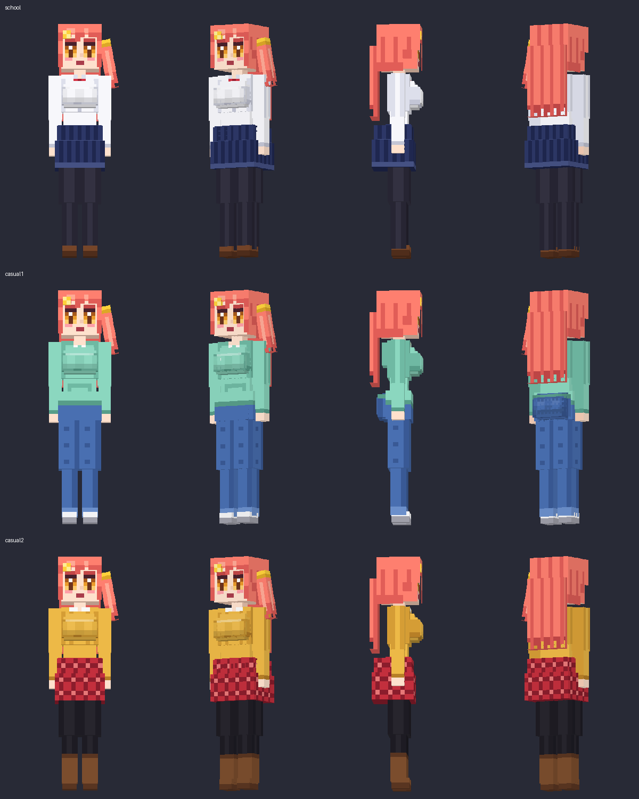
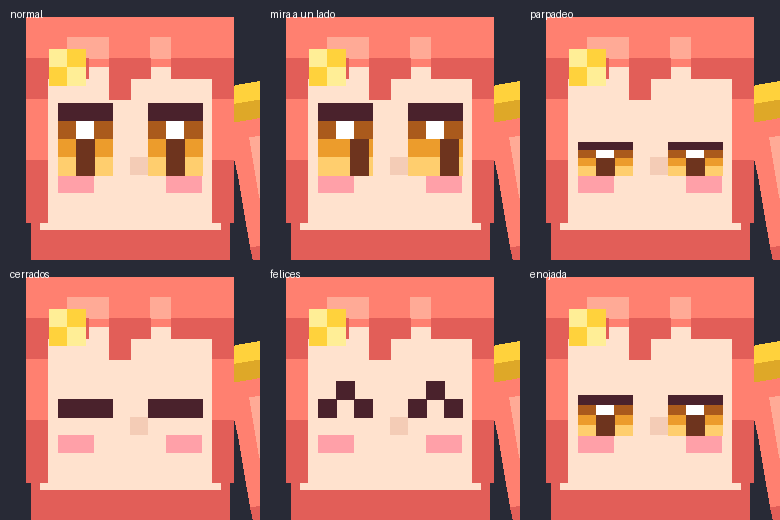
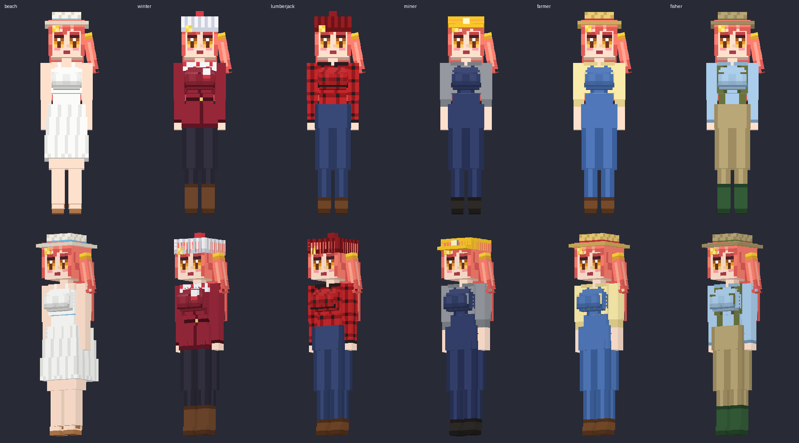
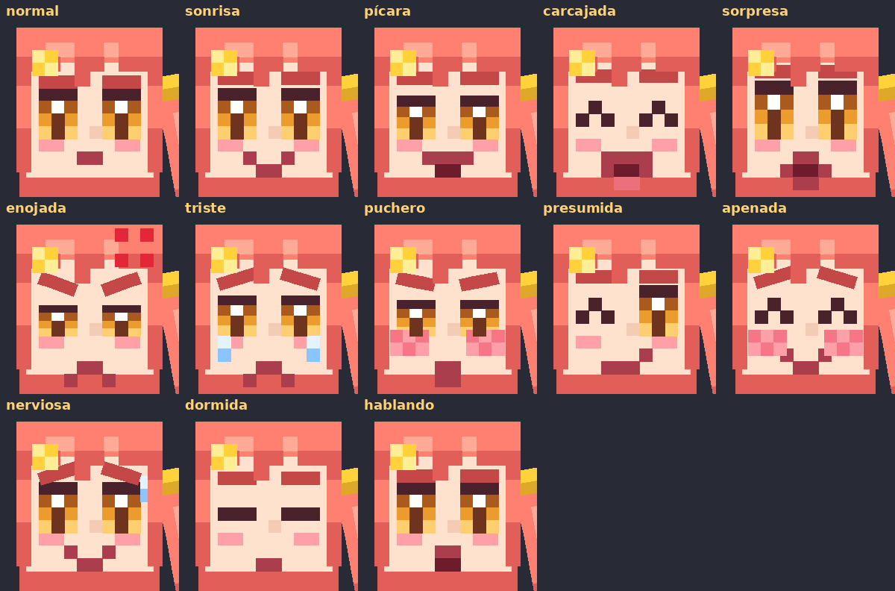
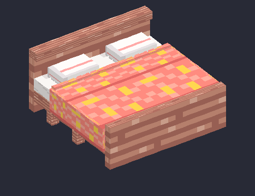

# Kiko Companion · Fase 2

Mod de Minecraft **1.21.1** para **Fabric** que agrega a Kiko, una compañera pícara y bromista que vive en las aldeas. Le das comida y regalos, le subes el afecto y termina siguiéndote a todos lados y madreando zombis por ti.

Kiko es un personaje 100 % original (pelo coral con coleta de lado, ojos ámbar y su pasador de estrella).











## Qué trae

- NPC con IA propia (pasea, te mira, se aleja si le caes mal, te sigue y te defiende si te quiere)
- Sistema de afecto de -100 a 100 por jugador, guardado en el mundo
- Menú propio con Shift + clic derecho, con submenús de ropa y de trabajos. Se queda quieta mientras le hablas
- 9 conjuntos de ropa: 3 casuales, playa (vestido blanco), invierno y 4 de trabajo. Se cambia sola según el trabajo y el lugar
- Opción para ocultar la armadura
- 6 chicas: Kiko, Maru la herrera, Lumi la tímida lectora, Nadi la exploradora, Rina la enfermera y Tami la chef, cada una con su casa en el mundo
- Todas cocinan platillos que llenan más (Tami mejor que nadie)
- Rasgos del jugador (hombre o mujer, piel, pelo y ojos), familia con cuna, hijos que heredan tus rasgos y crecen hasta tener oficio
- Novias y esposas con ramo y anillo, boda, celos y un bonus distinto por cada esposa. Ropa casual y vestido de novia para cada chica
- Menú rápido con la tecla K, marcador a través de las paredes, silbato, casa, mascota, montarse contigo en barca, ordenar cofres y expediciones de exploradora
- Expresiones faciales (boca que se mueve al hablar, cejas, sonrojo, sudor, lágrimas) y cama matrimonial de 2x2 donde duerme a tu lado
- Modelo con proporciones de adulta, rodillas y codos articulados
- Ojos animados (parpadeo, pupilas que siguen la mirada, ojos felices y entrecerrados cuando está enojada)
- Animaciones de caminar, respirar, cambiar el peso de pierna, saludar, aplaudir de gusto, cruzarse de brazos y golpear
- Aparece sola en las aldeas (junto a una cama) y también con huevo o `/summon kiko:kiko`
- Inventario propio de 27 espacios + 2 manos + 4 de armadura, el ítem y la armadura se ven puestos
- Pelea con cualquier arma de vanilla o de mods, y con arco o ballesta de lejos
- 10 trabajos: talar, bosque infinito, minar, túnel, escalera, aplanar, granja, animales, pescar y horno
- Va sola a guardar al cofre y pone antorchas en lugares oscuros
- Sonidos propios, partículas de corazones y estrellitas, diálogos en español e inglés
- Configuración en `config/kiko.json`

La guía de juego completa está en [GUIA.md](GUIA.md).

## Cómo compilarlo

Necesitas **Java 21** (el JDK, no solo el JRE). Si no lo tienes, bájalo de [Adoptium](https://adoptium.net/temurin/releases/?version=21).

En Windows, abre una terminal en la carpeta del mod y corre

```bat
gradlew.bat build
```

En Linux o Mac

```bash
./gradlew build
```

La primera vez tarda unos minutos porque baja Minecraft, Fabric y las dependencias. El `.jar` queda en `build/libs/kiko-companion-1.0.0.jar` (el que **no** dice `-sources`).

## Cómo instalarlo

1. Instala [Fabric Loader](https://fabricmc.net/use/installer/) para 1.21.1
2. Copia en tu carpeta `.minecraft/mods` el jar del mod y [Fabric API](https://modrinth.com/mod/fabric-api) para 1.21.1
3. Abre el juego con el perfil de Fabric

## Probarlo rápido sin instalar nada

```bash
./gradlew runClient
```

Abre un Minecraft de desarrollo con el mod ya cargado.

## Estructura

```
src/main/java/com/jaciel/kiko/
├── KikoMod.java                    inicializador (registra todo)
├── config/KikoConfig.java          config/kiko.json
├── registry/                       ModEntities, ModItems, ModSounds
├── entity/KikoEntity.java          la entidad (IA, NBT, sonidos, estados)
├── entity/ai/FollowFriendGoal.java seguir al mejor amigo
├── affection/                      sistema de afecto por jugador
├── interaction/                    qué pasa con cada clic derecho
├── outfit/KikoOutfit.java          los 4 conjuntos
├── animation/KikoAnimation.java    animaciones que manda el servidor
├── item/KikoOutfitItem.java        ítems de ropa
├── network/KikoNetworking.java     paquetes del menú
├── command/KikoCommands.java       /kiko ...
├── world/VillageSpawner.java       aparición en aldeas
└── client/
    ├── KikoClient.java             entrada del cliente
    ├── model/KikoModel.java        el modelo 3D
    ├── animation/KikoAnimationManager.java  todas las animaciones
    ├── render/KikoRenderer.java    escala y textura por outfit
    └── screen/KikoMenuScreen.java  el menú

blockbench/kiko.bbmodel             modelo editable en Blockbench (Modded Entity)
tools/gen_assets.py                 regenera texturas, íconos, bbmodel y vista previa
tools/gen_sounds.py                 regenera los sonidos
```

## Editar el modelo o las texturas

- Las texturas son PNG de 256x256 en `src/main/resources/assets/kiko/textures/entity/`, una por outfit. Las puedes abrir y pintar directo en Blockbench o en cualquier editor de pixel art.
- `blockbench/kiko.bbmodel` tiene la misma geometría para verla en Blockbench.
- La geometría vive en `tools/gen_assets.py` (lista `PARTS`). Al correr `python tools/gen_assets.py` se regeneran las texturas **y** el código del modelo en `KikoModel.java`, así nunca se descuadran.
- Los ojos son piezas aparte (`right_eye`, `left_eye`, pupilas, ojos cerrados y ojos felices). Si repintas la cara, no pintes ojos en la cabeza, van en esas piezas.

## Agregar un outfit nuevo

1. Agrega una línea en `outfit/KikoOutfit.java` (id, si lleva falda, si lleva capucha)
2. Copia una textura existente a `kiko_<id>.png` y píntala
3. Agrega `outfit.kiko.<id>` en `lang/es_mx.json` y `lang/en_us.json`
4. Si quieres ítem, regístralo en `ModItems` con su modelo en `models/item` y su receta

## Cambios respecto al prompt original

- El personaje, su nombre y su diseño son originales, y el comando es `/kiko`.
- Cada outfit tiene su propia textura en vez de una sola con UV cambiantes. Es más fácil de editar y no cuesta rendimiento.
- La velocidad quedó en 0.3 (la normal de un mob). Con 0.1 se movía en cámara lenta.
- Extiende `PathAwareEntity` (que hereda de `LivingEntity`) porque es la clase que trae navegación e IA.

## Pendientes

- Misiones, tareas y diálogos con opciones
- Más outfits desbloqueables
- Casa propia en las aldeas como estructura

